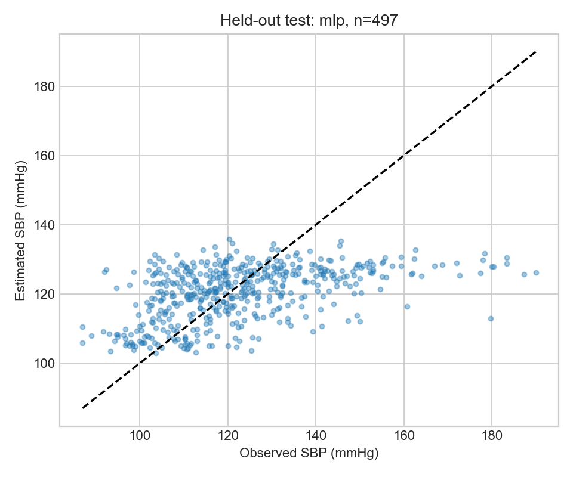

# Результаты исправленного эксперимента MedPredict-SBP-v2

Дата: 21 октября 2026 года. Источники чисел: [test_evaluation.json](../reports/test_evaluation.json), [validation_results.json](../reports/validation_results.json), [selection.json](../artifacts/selection.json), [data_audit.json](../reports/data_audit.json). Ниже приведены реально рассчитанные результаты; ошибки округлены до трёх знаков, единицы — мм рт. ст.

**Выбранная по validation MLP имеет test weighted MAE 11,225, но существенно недооценивает высокие значения: при наблюдаемом SBP ≥150 ошибка 41,366, и все 42 случая недооценены. Это исследовательская модель с неудовлетворительным поведением на краях target, а не клинически валидированная замена измерения.**

## История исправления и предел независимости test

Первый запуск отозван. pandas 2.2.3 превращал SAS XPT-нуль в `2**-260`, из-за чего 152 участника с фактически нулевым fasting weight попадали в выборку. Дефект подтверждён синтетическим примером, [upstream issue pandas #50670](https://github.com/pandas-dev/pandas/issues/50670) и независимым чтением тех же шести файлов через pyreadstat 1.3.1. Отличия: 2 033 нулевые ячейки demographics и 614 нулевых fasting weights; остальные числовые значения совпали. Число 614 и минимальный положительный вес 4 808,0699 согласуются с [P_GLU codebook](https://wwwn.cdc.gov/Nchs/Data/Nhanes/Public/2017/DataFiles/P_GLU.htm).

Старые код, конфиг, данные и результаты сохранены локально для аудита; полный архив исключён из Git. Публичный документ — [история отзыва v1](withdrawn-v1-status.md). Исправленный v2 использует прежние варианты моделей, гиперпараметры, seeds и правило выбора; техническая коррекция не выбиралась по удобству тестовой ошибки.

**Первоначальный некорректный test уже был просмотрен.** Поэтому v2 — исправленная внутренняя повторная оценка, а не новый полностью не просмотренный test или внешнее подтверждение. Это ограничение сохраняется даже при неизменной сетке настройки. Старые числа v1 не смешиваются с таблицами v2.

## Данные и выбор модели

После исправления: 3 318 complete-case участников NHANES 2017–March 2020, возраст 18–79, положительный fasting weight. Разбиение: train 2 324, validation 497, test 497. Target — среднее минимум двух валидных осциллометрических SBP одного обследования. Исходный протокол, математическая постановка и отбор: [experiment-design.md](experiment-design.md), [dataset-selection.md](dataset-selection.md).

Сопоставлены mean, четыре Ridge alpha, две конфигурации бустинга и девять MLP-запусков: три конфигурации × три seeds. Для MLP конфигурация выбрана по среднему validation weighted MAE трёх seeds; заранее установлен представитель seed 2026, а не лучший seed после просмотра test. Выбранная сеть: `5 → 32 → 16 → 1`, ReLU, dropout 0,1, AdamW weight decay 0,05, learning rate 0,001; 737 параметров.

| Семейство | Выбранная настройка | Validation weighted MAE |
|---|---|---:|
| Mean | Взвешенное среднее train | 12,651 |
| Ridge | alpha = 10 | 10,732 |
| Histogram Gradient Boosting | 7 листьев, L2 = 10, lr = 0,05, 200 итераций | 10,801 |
| MLP, seed 2026 | 32/16, dropout 0,1 | **10,342** |

Средние validation weighted MAE MLP-конфигураций: 32/16 без dropout — 10,377; 16 — 10,386; 32/16 с dropout — 10,365. Различия невелики; они не доказывают универсальную оптимальность выбранной архитектуры. В девяти запусках выполнено 73–182 эпохи с early stopping. [Кривые и журнал](../reports/training_curves.json).

## Сравнение на исправленной test-части

| Модель | Weighted MAE | Weighted RMSE | Weighted R² | Невзвешенная MAE | Невзвешенная RMSE | Невзвешенный R² | MedianAE |
|---|---:|---:|---:|---:|---:|---:|---:|
| Mean | 13,231 | 17,140 | −0,00003 | 14,024 | 18,462 | −0,018 | 11,316 |
| Ridge | 11,268 | **15,149** | **0,219** | 12,399 | 16,425 | 0,194 | **9,786** |
| Histogram Gradient Boosting | 11,698 | 15,732 | 0,158 | 12,515 | 16,455 | 0,191 | 10,466 |
| MLP, выбранная до test | **11,225** | 15,309 | 0,202 | **12,396** | **16,381** | **0,199** | 9,847 |

У MLP weighted MAE ниже mean на 2,006, но отличается от Ridge всего на 0,043. Ridge лучше по weighted RMSE/R² и MedianAE. Парный интервал различия MLP–Ridge этим запуском не рассчитывался; статистически надёжное превосходство MLP над Ridge **не установлено**. Семейство приложения не переключалось по test: MLP сохранена по исходному validation-правилу.

R² около 0,20 не означает «точность 20%». Это коэффициент относительно вариации target на конкретной части данных. Средняя ошибка также не является границей ошибки каждого отдельного пациента. [Определения метрик](https://scikit-learn.org/stable/modules/model_evaluation.html#regression-metrics).

После 1 000 stratified masked-PSU bootstrap-повторов условный интервал weighted MAE MLP: **10,141–12,221**; для разницы MLP–mean: **−2,650…−1,392**. Это исследовательские интервалы при фиксированных модели/complete-case test, не полная survey variance, не внешняя валидация и не индивидуальный prediction interval. Методические пределы изложены в протоколе и [CDC Variance Estimation](https://wwwn.cdc.gov/nchs/nhanes/tutorials/VarianceEstimation.aspx).

На scatter видна концентрация оценок в центральной области при высоких наблюдаемых значениях. Это согласуется с количественным анализом знака ошибок ниже; само изображение не устанавливает причину недостатка информации или причинные связи признаков.

## Ошибки MLP по группам

Знак ошибки: оценка минус наблюдаемое давление. Диапазоны target — заранее заданные исследовательские интервалы, не диагностические классы.

| Наблюдаемый SBP | n | Weighted MAE | Взвешенная знаковая ошибка |
|---|---:|---:|---:|
| <110 | 124 | 12,152 | +12,036 |
| 110–<130 | 223 | 5,932 | +1,563 |
| 130–<150 | 108 | 12,730 | −12,520 |
| ≥150 | 42 | **41,366** | **−41,366** |

Все 42 наблюдения последней группы недооценены; группа мала, но выраженный провал скрывать общей MAE нельзя. В нижней группе наблюдается завышение. Надёжная оценка крайних значений зарегистрированным подходом не получена; на его основе нельзя принимать клинические решения.

Другие описательные срезы:

| Группа | n | Weighted MAE |
|---|---:|---:|
| Возраст 18–39 | 179 | 8,412 |
| Возраст 40–59 | 160 | 12,524 |
| Возраст 60–79 | 158 | 13,708 |
| Female по кодировке NHANES | 245 | 13,061 |
| Male по кодировке NHANES | 252 | 9,476 |
| Текущие назначенные препараты от давления: yes | 114 | 18,291 |
| Ответ no | 43 | 16,029 |
| Unknown/skip | 340 | 9,116 |

Эти сравнения не скорректированы по различиям состава групп и множественным проверкам; это не доказательство причинного эффекта пола/возраста/препаратов. Unknown/skip не равно отсутствию лечения. Общая взвешенная знаковая ошибка −0,677 существенно меньше ошибок крайних групп и не доказывает хорошую индивидуальную калибровку.

На validation permutation sensitivity среднее увеличение weighted MAE при перестановке: возраст 2,445; пол 1,121; ИМТ 0,165; холестерин 0,371; глюкоза 0,251. Это зависимость конкретной модели от входов, а не причинное влияние показателей. Слабая permutation sensitivity не доказывает отсутствие медицинской связи.

Дополнительные рисунки: [остатки](../reports/figures/residuals.png), [сравнение моделей](../reports/figures/model-comparison.png), [возраст](../reports/figures/error-by-age.png), [пол](../reports/figures/error-by-sex.png), [диапазон target](../reports/figures/error-by-target_range_research_bins.png), [приём препаратов](../reports/figures/error-by-medication.png), [распределения](../reports/figures/data-distributions.png), [описательные корреляции](../reports/figures/data-correlations.png), [training/validation](../reports/figures/training-validation.png).

## Runtime и ONNX

В сохранённой среде `macOS arm64`, CPU, MLP training суммарно заняло 8,612 с для девяти запусков; это измерение данной машины, не обещание скорости на другом устройстве. Python preloaded MLP, одна строка: p50 0,03996 мс, p95 0,04142 мс, 200 повторов.

В [onnx_verification.json](../reports/onnx_verification.json) проверены 501 вектор: исправленная test-часть 497 и четыре синтетических golden examples. Максимальное расхождение PyTorch/ONNX Runtime — **0,00001526 мм рт. ст.**, допуск 0,01. Основной ONNX: 4 733 байта, SHA-256 `3a4be6a1746f4230a5dba7346e3948e56cabc400540c91b0fbcd7882299dbe2a`. Preprocessing и обратное преобразование target встроены в граф. Отдельный `mlp-experimental.onnx` имеет тот же checksum, поскольку MLP одновременно выбрана для приложения.

ONNX CPU, одна строка, 1 000 повторов: p50 0,005458 мс, p95 0,005833 мс. Это локальные времена уже загруженной модели; они не включают HTTP, startup или интерфейс.

Для этого же v2 SHA [java_verification.json](../reports/java_verification.json) подтверждает четыре synthetic golden examples в Java ONNX Runtime 1.24.3: максимальная разница с Python-reference **0,00000763 мм рт. ст.**, допуск 0,01, parity passed. Отчёт также фиксирует 48 backend-тестов, 0 failures/errors/skips, успешную сборку packaged JAR и HTTP readiness. Это результат обновлённого артефакта, а не перенос проверки отозванного v1. Совпадение runtime не уменьшает статистическую ошибку модели и не делает её безопасной для клинического применения.

## Вывод и дальнейшая работа

Реализованы настоящие данные, собственные обученные веса, контроль источников/утечек, сравнение с baseline, прозрачная техническая коррекция и ONNX-проверка. Исследовательский результат скромный: общее улучшение относительно constant mean сопровождается сильным систематическим занижением высоких SBP; убедительное преимущество нейросети над Ridge не показано.

Следующие исследования требуют отдельной регистрации, более полного клинического контекста, обоснования признаков и независимых данных. Не следует донастраивать текущий эксперимент по увиденному test. NHANES 2021–2023 может дать временную проверку в США после согласования измерений и схемы; применимость к Казахстану и клиническая валидация не выполнены.
