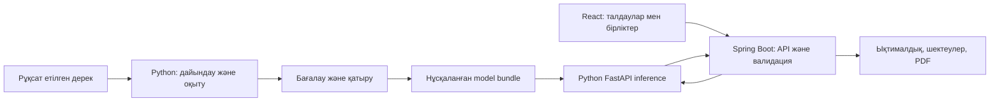

# MedPredict: зертханалық талдаулар бойынша диагностикалық ML бағытына көшу жоспары

2026-10-27 орындалу мәртебесі: пайдаланушы scope-ты тек ML/AI деп нақтылады; frontend/Java backend өзгерістері бұл іске асыруға кірмейді. Нақты нәтиже мен ашық қалған clinical/data gates — [орындалу есебінде](../implementation-status-2026-10-27.md). Төмендегі бастапқы жоспар орындалған жұмыс туралы автоматты мәлімдеме емес.
Күні: 26 қазан 2026. Нұсқа: 2, senior ML engineering execution plan. Мәртебесі: іске асыруға арналған ұсыныс; төмендегі G0–G5 шарттары нақты дәлелмен жабылады. Бұл құжат жаңа модель оқытылғанын, API өзгергенін немесе медициналық қолдану мақұлданғанын білдірмейді. Бұрынғы M1/M2/M3 жоспары тарихи күйінде сақталады.

## 1. Негізгі шешім

Ұзақ мерзімді мақсат: қолжетімді зертханалық нәтижелер мен клиникалық контекст арқылы алдын ала келісілген аурулардың ықтималдығын бағалау. Бірінші зерттеу нұсқасы бір нақты диагностикалық сұрақты шешеді. «Барлық анализ → кез келген аурудың нақты диагнозы» деген шексіз міндетке сапаны тексеру мүмкін емес.

Ұсынылатын алғашқы бағыт — диабетке қатысты скрининг зерттеуі. Нақты алғашқы эксперимент `D1-HBA1C-SCREEN`: HbA1c кірісте жоқ кезде сол тексерудегі жоғары HbA1c критерийіне сәйкестік ықтималдығын бағалау. Бұл расталған диабет диагнозы да, болашақ ауру қаупі де емес. Оның нақты паспорты 12-бөлімде. Дәрігер растаған диагнозға арналған `D2-DIAGNOSIS` тек reference-standard дерегі пайда болғанда жеке басталады; D1 нәтижесін D2 деп қайта атауға болмайды.

ML дайындау, оқыту, бағалау және жаңа inference модулі Python-да жазылады. Дайын React интерфейсін пайдаланамыз. Қолданыстағы Java backend-ті қайта жазу бірінші ML кезеңіне кірмейді; ол жаңа Python сервисіне сұрау жіберетін шекара бола алады. Егер команда бүкіл backend-ті Python-ға ауыстыруды таңдаса, бұл бөлек көшіру жұмысы және API үйлесімділігін тексеру болады.

Нәтиже зерттеу сипатындағы көмекші бағалау болады; дәрігерлердің нақты workflow-ына жарамдылығы әлі тексерілмеген. Қосымша тек модель қолдайтын жағдайларды бағалайды; төмен ықтималдық «адам сау» деген қорытынды емес. Диабетті клиникалық анықтауда тест нәтижелерін растау қажет болуы мүмкін [S5].

## 2. Нақты тексерілген бастапқы күй

GitHub-тағы репозиторийлер 26 қазанда бөлек shallow clone арқылы қаралды. README-мен бірге backend провайдерлері, service/DTO және frontend типтері, HTTP адаптері, парсері, нәтиже/PDF байланыстары тексерілді. Жергілікті workspace жарияланған кодпен бірдей деп қабылданбады.

| Бөлік | Тексерілген күй | Жоспарға әсері |
|---|---|---|
| frontend, `63e95fa3d189b8f68999d86bed6407d67ae732d8` | React/TypeScript; metadata бойынша форма; тексерілген HTTP жауап; отмена/ескірген жауаптан қорғаныс; PDF. Нәтиже типі бір `predictedValue` санына арналған | Диагностикалық нәтиже үшін типтер, парсер, экран және PDF өзгереді |
| backend, `7a420362505a9a62821b5fdda17f5f40bc951eb7` | Java/Spring Boot; `PredictionModel` интерфейсі; default unavailable және тұрақты 134.2 беретін demo; жарияланған кодта ONNX провайдері жоқ | HTTP `real` режимін дайын ML деп есептеуге болмайды; Python провайдері қажет |
| ml-ai, `c437444e957895e400e7a9698d81f2abac4417eb` | README және архитектура материалдары бар; Python пакет/оқыту коды жоқ | Жергілікті ML пакетінің жарияланатын құрамын дайындау керек; push осы жоспардың бөлігі емес |
| Жергілікті `ml/` | NHANES бойынша Python pipeline, MLP/baselines, ONNX және агрегатталған есептер бар | Қолданыстағы дерек тексеру, split, export/parity тәсілдерін қайта қолдану |
| Берілген PDF, 24 қазан | M2 — қазіргі САД регрессиясы; M1 — бір жылдық progression; M3 — болашақ глюкоза. Диагностика бастапқы scope-тан тыс | Диагностикалық мақсат үшін requirements, evaluation plan және ғылыми сұрақтарды жаңарту керек |

PDF пен жергілікті есепте M2 weighted MAE 11.225 мм рт. ст., Ridge 11.268; САД ≥150 тобындағы 42 бақылаудың бәрі төмен бағаланған. Бұл сақталған ішкі эксперимент нәтижелері, осы зерттеуде қайта есептелген жоқ. Осы қысым бағасынан гипертония диагнозын шығаратын ереже жасалмайды. Бұрынғы test-тің қаралғаны және Қазақстанда сыртқы валидацияның жоқтығы сақталады.

Негізгі код нүктелері: frontend `src/types.ts`, `src/api/contract.ts`, `src/api/http.ts`, `src/hooks/usePrediction.ts`, `src/components/ResultPanel.tsx`, `src/pdf/report.ts`; backend `prediction/infrastructure/model/`, `prediction/service/impl/PredictionServiceImpl.java`, `prediction/model/dto/`. Репозиторий сілтемелері: [S1–S3].

## 3. Қандай аурулар және қандай талдаулар

Бұл кесте — кезеңдік зерттеу ұсынысы; дайын модельдер не жеткілікті медициналық критерийлер тізімі емес. Әр жолда дәрігермен келісілген жеке target және бөлек дерек аудиті керек.

| Кезең | Зерттеу сұрағы | Ықтимал кірістер, деректе және қолдану сәтінде бар болса | Негізгі шектеу |
|---|---|---|---|
| Бірінші | HbA1c белгісіз кезде жоғары HbA1c критерийіне сәйкестік | Жас, жыныс, BMI, ашқарындағы глюкоза, холестерин; анамнез/ем тек eligibility үшін | Бір тексерудің screening label-ы, расталған диабет диагнозы емес |
| Кейін | Анемияның бар болу ықтималдығы / зертханалық белгісі | Hb, MCV, MCH, RDW, RBC, қажет болса ферритин және контекст | Анемия белгісі оның себебін анықтаумен бірдей емес |
| Кейін | Бүйрек функциясының бұзылу белгісі / созылмалы ауруға қатысты нақты target | Креатинин, eGFR, зәр альбумині, ACR, бұрынғы нәтижелер | Бір реттік ауытқу созылмалы диагнозды растамайды |
| Кейін | Басқа нақты бекітілген жағдай | Сол жағдайға қатысты зертханалық және клиникалық белгілер | Жеке label, жеткілікті оң жағдай және бөлек валидация қажет |

Бір пациентте бірнеше жағдай болуы мүмкін. Сондықтан кейінгі архитектура бірнеше жеке binary модельден бастала алады; оларды multi-label нәтиже ретінде көрсетуге болады. Ауруларды бірін-бірі жоққа шығаратын softmax санаттарына күштеп біріктірмейміз. Модель тек өзінде зерттелген ауруларды қамтиды.

Бірінші нұсқада тек құрылымдалған сандық/категориялық енгізу болады. PDF/OCR, суреттер, генетика, мәтіндік chatbot, барлық сирек ауру және автоматты ем тағайындау кірмейді.

## 4. Оқыту деректері

Талап етілетін байланыс: бір адамның белгілі уақытқа дейін қолжетімді көрсеткіштері → алдын ала анықталған тәсілмен расталған outcome. Тек анализдері бар кесте supervised диагноз моделіне жеткіліксіз.

Әр дереккөзге паспорт жасалады: нұсқа, құқық/рұқсат, SHA-256, когорта, уақыт аралығы, бірегей адамдар және оң/теріс/белгісіз жағдайлар саны, өлшем бірліктері, label тәсілі, пропусктар, алып тастаулар. Қажетті sample size белгілер саны, ауру таралуы және метрикалардың талап етілетін дәлдігі бойынша жоспарланады; «1000 жол жеткілікті» деп алдын ала бекітілмейді.

Кандидаттар:

- **NHANES:** қолданыстағы ingestion тәжірибесін және зертханалық codebook-тарды пайдалану ыңғайлы. Бірақ әр ауруға gold-standard диагноз бар деп есептемейміз. Survey design, weights және fasting subsample ескеріледі [S4].
- **MIMIC-IV:** клиникалық дерекке кандидат; рұқсат, credentialing, training және data-use agreement талап етіледі. Аурухана дерегін амбулаториялық Қазақстан қолданушысына тікелей жарамды деп жарияламаймыз. ICD кодтары сараптамалық растаусыз мінсіз label болмайды; кейін жазылған discharge кодтарын ертеректегі белгілермен уақыт жағынан тексеру керек. Туынды модельдерді таратуға да дереккөз шарттары қолданылады [S6].
- **Қазақстан клиникасымен рұқсат етілген дерек:** жергілікті тексеруге ең тікелей жол; қолжетімділігі әлі расталмаған. Иесіздендіру, қолжетімділік және зерттеу рәсімі дерек алудан бұрын бекітіледі.

Әртүрлі датасеттердегі бөлек адамдардың анализдерін бір адамның «толық картасына» біріктіруге болмайды. Белгісіз диагнозды `0`/«сау» деп белгілемейміз. Синтетикалық мысалдар тек бағдарламалық тестке арналған, медициналық сапаның дәлелі емес.

### Label leakage-ті болдырмау

Егер target сол HbA1c немесе глюкозаның шегінен есептелсе және сол талдау кірісте болса, модель диагнозды тәуелсіз үйренбейді: шекті қайта өндіреді. Мұндай жағдайда ашық, дәрігер мақұлдаған ереже baseline ретінде көрсетіледі; ML-дің сол ережеден қосымша құны бөлек сұрақ болады.

Балама зерттеу — растаушы анализсіз, одан бұрынғы қолжетімді белгілерден кімге қосымша тексеру қажет екенін бағалау. Бұл басқа intended use; оны барлық анализ қосылған модельмен араластырмаймыз. Белгілер тізімі, index time және outcome-ты растау уақыты оқытудан бұрын жазылады.

## 5. Python экспериментінің реті

1. **Task specification:** бір target, аудитория, қолжетімді кірістер уақыты, label анықтамасы және қолдану шегін бекіту.
2. **Data audit:** типтер, дубликаттар, бірліктер, пропусктар, уақыт және label тексеруі. Барлық талдау міндетті емес; әр модельге өзінің минималды панелі анықталады.
3. **Frozen split:** бір адамның барлық жазбасы бір бөлікке ғана түседі. Уақыттық міндетте уақыт бойынша бөлінеді; клиника/мерзім бойынша тәуелсіз бөлік болса, бөлек external evaluation қалады.
4. **Preprocessing:** imputer/scaler/encoding тек train ішінде үйретіледі, CV кезінде әр fold ішінде қайталанады. Label ешқашан толтырылмайды. Пропуск үлгісін және imputation ықпалын бөлек тексеру керек.
5. **Baselines:** prevalence/қарапайым dummy; label-ге сәйкес медициналық ереже бар болса, бөлек rule baseline; LogisticRegression; HistGradientBoostingClassifier.
6. **Нейросеть:** шағын PyTorch MLP. Binary target үшін бір logit және BCEWithLogitsLoss; class imbalance тәсілі тек train-де таңдалады. Үлкен Transformer бірінші міндет емес.
7. **Selection:** шектеулі конфигурациялар, CV/validation арқылы таңдау. Калибровка мен decision threshold train/CV/validation ішіндегі дерекпен анықталады, final test қолданылмайды.
8. **Final evaluation:** модель, threshold және pipeline бекітілгеннен кейін жабық test ашылады. Одан кейін жақсарту жасалса, бұрынғы test тәуелсіз дәлел ретінде қайта ұсынылмайды.
9. **Bundle:** модель, preprocessing, schema, нұсқа, дерек provenance, split/protocol, metrics, model card, checksum және синтетикалық golden vectors.

Қолданыстағы `medpredict_ml` пакетінің пайдалы I/O, seed және тексеру үлгілері сақталады. Қысым регрессиясының `train/evaluate/export` кодын classifier-ге жасырын бейімдемейміз; жаңа task анық бөлінеді. Пайдасы дәлелденбеген ортақ framework жасалмайды.

## 6. Нені өлшейміз және қашан тоқтаймыз

Әр ауруға: prevalence және sample count, AUROC, AUPRC, sensitivity/recall, specificity, PPV/precision, NPV, confusion matrix; ықтималдық үшін Brier score және calibration plot. Метрикалар пациент деңгейіндегі сенім аралықтарымен беріледі. Тек accuracy немесе «95% дәлдік» жеткіліксіз [S7].

Threshold-ты дәрігермен intended use-қа сай таңдаймыз: жалған теріс және жалған оң нәтиженің салдары әртүрлі. Универсалды 0.5 шегін немесе дәлелсіз 90–95% мақсатты тағайындамаймыз. Класс салмақтары қолданылса, ықтималдық калибровкасы бөлек тексеріледі.

Жас, жыныс, клиника/дерек кезеңі, дәрі қабылдау және пропуск үлгілері бойынша қателер көрсетіледі; шағын топқа сенімділік жөнінде ескерту беріледі. Сыртқы когортада модель қатырылады және барлық алдын ала бекітілген метрика бағаланады. Қазақстанға жарамдылық бөлек жергілікті зерттеуді талап етеді; TRIPOD+AI есептілігін қолданамыз [S8].

Stop/go шарттары:

- Расталған label немесе рұқсат жоқ болса — диагноз моделі оқытылмайды, алдымен дерек мәселесі шешіледі.
- Оң жағдай жеткіліксіз болса — ауру саны қысқарады не қосымша дерек жиналады; артық synthetic oversampling дәлел орнына жүрмейді.
- ML rule/baseline-нан пайдалы артықшылық көрсетпесе — нәтижені солай жариялаймыз, күрделілікті өсіру міндетті емес.
- Калибровка нашар, кіріс жарамсыз немесе қолдану аймағынан тыс болса — санды мәжбүрлеп көрсетпейміз; шектеуді/бағалау мүмкін еместігін қайтарамыз.

## 7. Интеграция архитектурасы



FastAPI/Pydantic жаңа Python сервисінің сұрау/жауап схемасына және OpenAPI-ға қолданылады [S9]. Қосымша Python сервисі — жаңа ұсыныс, қазіргі репозиторийдің мүмкіндігі емес. Ішкі сервиске тікелей қоғамдық қолжетімділік берілмейді; backend address/timeout конфигімен басқарылады. Ескі M2 ONNX жолын көшіру міндетті емес.

Inference алдында тип/бірлік/категория/дерек уақыты тексеріледі. Белгісіз бірліктерден болжап конверсия жасалмайды; бекітілген mapping қана қолданылады. Лаборатория reference interval-ы модельдің train domain-імен бір нәрсе емес. Inference model bundle-мен бірге бекітілген preprocessing-ті ғана қолданады.

Модель процесс іске қосылғанда бір рет жүктеледі; `/health` пен model readiness ажыратылады. SHA/schema сәйкес келмесе, timeout не inference қатесі болса — нақты қате. Demo-ға автоматты ауысу және HTTP сұрауы кезінде retraining болмайды. Тек тексерілген жергілікті артефакт жүктеледі.

## 8. API және frontend өзгерісінің толық көлемі

Төмендегілер — келісуге арналған v2 контракт ұсынысы, әзірге жұмыс істейтін endpoint емес. Оралханмен келісіліп, contract tests және docs бірге жаңартылады. Қолданыстағы v1 сандық контракт сақталады.

- `GET /api/v2/assessments/schema`: қолдайтын condition/task, input fields, бірліктер, required/optional, cohort шектеулері, schema/model version және readiness.
- `POST /api/v2/assessments`: task идентификаторы, schema version және құрылымдалған observations/context. Нақты request fixture-лері тек бірліктер мен дерек паспорты бекітілгеннен кейін жасалады.
- Жауап: `status`, `task`, `modelVersion`, `researchOnly`, қолжетімді жағдайда `findings[]` ішіндегі condition және калибровкасы тексерілген probability; сондай-ақ missing inputs және limitations. Бір аурудың ықтималдығы басқа аурулармен бірге 100%-ға қосылуы міндетті емес.
- «Дерек жеткіліксіз» valid clinical assessment state ретінде, «қате формат/бірлік» validation error ретінде, «модель дайын емес» 503 ретінде анық бөлінеді. Қолдамайтын condition-ға жалған ықтималдық берілмейді.

Өзгеріс жететін орындар:

| Қабат | Міндетті жұмыс |
|---|---|
| ML/Python | Task schema, дерек/label адаптері, classifier training/evaluation, bundle loader, FastAPI, тесттер |
| Backend | V2 DTO/controller/service, Python HTTP client, timeout және error mapping, schema/output validation, readiness/config, OpenAPI және tests |
| Frontend | V2 types/парсер/адаптер; модуль формасы; `usePrediction` не жаңа task state; ResultPanel; PDF; RU/KK/EN мәтіндері |
| Сценарий қорғанысы | Task/кіріс өзгергенде ескі нәтиже өшеді; cancel, keyboard focus, field errors, request identity сақталады |
| Fixtures және құжаттар | Синтетикалық API/PDF fixtures, requirements, API contract, architecture, evaluation plan, model card, README |

Нәтиже мәтіні: «Зерттеу моделінің бағалауы», қамтылған жағдай, тексерілген ықтималдық, қандай кіріс қолданылғаны, қандай дерек жетіспегені және қолдану шектеуі. «Нақты диагноз қойылды», жалған confidence score, дәрі/доза ұсыну болмайды. Түсіндірме модельдің себеп-салдарды дәлелдейтін тұжырымы ретінде берілмейді.

## 9. Құпиялық және тексеру

Медициналық мәндер URL-ға, console/application/APM логтарына, аналитикаға, localStorage/sessionStorage-қа жіберілмейді. Нақты адам аты/телефоны бірінші assessment-ке қажет емес. PDF тек пайдаланушының explicit әрекетімен жасалады. Сұраулар автоматты train дерегіне айналмайды; тарих/аккаунт тек бөлек келісілген access, retention және deletion талабынан кейін қосылады.

Минималды маңызды тексерулер:

1. Data: адам split арасында қайталанбайды; join дубликаттары, label missing, болашақ дерек және бірлік қателері ұсталады.
2. ML: train-only fit, dummy/rule baseline comparison, reproducibility, calibration және негізгі метрикалар есептеледі.
3. Inference: Python reference пен served bundle синтетикалық vectors-та келісілген tolerance ішінде сәйкес; missing/unknown field/NaN/Inf/қате бірлік қабылданбайды.
4. Backend contract: Python unavailable, timeout, malformed output, model/schema mismatch кезінде қауіпсіз қате; demo fallback жоқ.
5. Frontend integration/E2E: синтетикалық енгізу, нақты Python сервисі, қате сценарийлері, cancel/stale response, desktop/mobile, RU/KK/EN, PDF-те сол нәтиже және нұсқа.

Жаңа Python кодына pytest; frontend өзгерісіне typecheck/lint/unit/build және тиісті E2E; backend өзгерісіне Maven tests. Сервистің p50/p95 және жүктелу уақыты нақты ортада өлшенеді, алдын ала жылдамдық кепілдігі берілмейді.

## 10. Жұмыс кестесі

Бір алғашқы ауру бойынша зерттеу прототипіне **8–12 апта** — дерекке уақытылы қолжетімділік болғандағы инженерлік бағалау. Клиника рұқсаты, дерек жинау және сыртқы/клиникалық валидация мерзімі бұған кепілдендірілмейді. Барлық ауруды қамтитын өнімге бұл мерзім жүрмейді.

| Кезең | Ориентир | Ұсынылатын жауапты | Нәтиже және өту шарты |
|---|---|---|---|
| Мақсатты бекіту | 1-апта | Али + команда + дәрігер/жетекші | Ауру, intended use, label, кіріс уақыты, критерийлер және scope өзгерісі |
| Дерек және source сәйкестігі | 1–2-апта | Али; backend/frontend иелері | Дерек паспорты, қолжетімділік, version inventory; жергілікті ML пакетінің жариялауға дайын құрамы |
| Dataset және baselines | 3–4-апта | Али | Leakage audit, frozen split, prevalence/rule/logistic/tree нәтижелері |
| MLP, калибровка, final test | 5–6-апта | Али | Frozen bundle, метрика/CI, subgroup report, model card; go/no-go |
| V2 келісімі және Python inference | 4–7-апта | Оралхан + Али | Contract fixtures, readiness, service және backend adapter tests |
| Интерфейс және PDF | 6–8-апта | Санат | Жаңа нәтиже, бірліктер, қате/жетіспейтін дерек, үш тіл, cancellation |
| Тәуелсіз тексеру және демо | 9–12-апта | Команда; клиникалық сарапшы | Reproduction, қолжетімді external evaluation, E2E, шектеулер және келесі шешім |

Клиникалық сарапшының нақты қатысуы әлі расталмаған. Кестедегі міндеттер — бұрынғы команда рөлдеріне сүйенген ұсыныс, орындалған жұмыс туралы мәлімдеме емес.

### Алғашқы бес жұмыс күні

1. Али: «қай диагноз, кімге, қай сәтте, label қалай расталады?» деген бір беттік task specification.
2. Али: кандидат деректер бойынша feature/label mapping және positive/negative/unknown аудиті; жарамдылық туралы шешім.
3. Команда: жергілікті ML мен public main айырмасын inventory-ге түсіру, raw data/құпия файлдарды жарияланатын пакеттен алып тастау.
4. Али: split/protocol және baseline критерийін қатыру; лицензиясы рұқсат ететін дерекпен алғашқы baseline.
5. Оралхан/Санат: тек синтетикалық fixture бойынша v2 схемасын және нәтиже макетін келісу. Модель дайын болмаса, unavailable күйі көрсетіледі.

## 11. Алғашқы нұсқаның аяқталу шарты

Басқа қатысушы жазылған командалармен дерек дайындауды және экспериментті қайталай алады; provenance/label/split түсінікті; baseline мен MLP әділ салыстырылған; модель нұсқасы мен preprocessing бірге бекітілген; Python → backend → frontend → PDF жолында бір нәтиже сақталады; қате және дерек жеткіліксіз күйі тексерілген. Медициналық шектеулер және сыртқы валидация күйі жасырылмайды. Оң ғылыми нәтиже болмауы инженерлік экспериментті автоматты түрде сәтсіз етпейді.

## 12. Бірінші эксперименттің нақты паспорты

Бұл бөлім жалпы ауру тізімінен бірінші орындалатын міндетті бөледі. Нақты диагноз туралы дәлел пайда болғанша оның атауы мен scope-ы өзгермейді.

| Өріс | Бекітілуге ұсынылған шешім |
|---|---|
| Task ID | `D1-HBA1C-SCREEN-v1` |
| Сұрақ | HbA1c нәтижесі белгісіз кезде қолжетімді табличный белгілер сол тексерудегі жоғары HbA1c критерийін қаншалықты жақсы ажыратады? |
| Дерек | NHANES 2017–March 2020; бөлек D1 cohort. M2-нің 3318 қатысушысын автоматты қайта пайдаланбаймыз |
| Бақылау бірлігі | Бір `SEQN` — бір адам. Бір тексерудің байланыстырылған кестелері; longitudinal болжам емес |
| Бастапқы аудитория | 18–79 жас, жүктілігі жоқ екені деректе тексерілетін, бұрын диабет туралы хабарламаған және глюкозаны төмендететін ем қабылдамайтын когорта. Осы шарттардың белгісіз мәндері бөлек есептеліп, primary cohort-тан шығарылады |
| Target | `LBXGH >= 6.5` болған бір зертханалық тексеру критерийі, HbA1c бірлігі %. Бұл клиникалық қайталама растау емес; шектен төмен нәтиже де «толық сау» label-ы емес [S5, S10] |
| Primary inputs | `age`, `sex`, `bmi`, `totalCholesterol`, fasting `glucose`; HbA1c жоқ. Қолданыстағы feature order тек D1 schema-да арнайы бекітілсе пайдаланылады |
| Missing policy | D1 v1 — бес primary input-ы complete-case; inference-те жетіспесе `insufficient_data`. Train-де missing input/target толтырылмайды. Imputation тек жеке predeclared эксперимент болса енгізіледі |
| HbA1c белгілі болса | Осы screening моделін шақырмаймыз; бар нақты талдауды көрсететін бөлек интерпретация workflow-ы қажет. Модель өлшенген нәтижені қайта болжауға қолданылмайды |
| Кірмейтін белгілер | HbA1c және одан жасалған туындылар, диагноз label-ы, диабет емін көрсететін белгілер, идентификаторлар, survey weights, болашақ ақпарат |
| Негізгі салыстыру | Train prevalence dummy; тек fasting glucose қолданатын LogisticRegression; барлық кірісі бар LogisticRegression; HGB; шағын MLP |
| Мәні | Жас/BMI/липидтер қосу глюкозаның өзінен алынатын ақпаратқа қосымша құн бере ме? Нейросеть қарапайым модельден артық па? |
| Демо мәртебесі | `researchOnly=true`, `clinicalValidation=not_established`; «диабет ықтималдығы» орнына жоғары HbA1c критерийіне сәйкестік ықтималдығы |

6.5% — NIDDK сипаттайтын, жүкті емес адамдарға қатысты диагностикалық тест шегі; осы зерттеуде ол бір өлшеудің **операциялық label анықтамасы** ғана. HbA1c-ке әсер ететін жағдайлар мен зертханалық әдістер dataset audit/model card ішінде тексеріледі; қолда бар дерек бәрін алып тастауға жеткіліксіз болса, қалдық шектеу жазылады. Диабеттің түрін бұл label анықтамайды.

### D1 source-to-feature mapping

| Пайдалану | Дерек айнымалысы / файл | Тексеру |
|---|---|---|
| Join key | `SEQN`, барлық кестелер | Әр source ішінде unique; `validate=one_to_one`; join flow counts |
| Жас/жыныс | `RIDAGEYR`, `RIAGENDR` / `P_DEMO` | Жас 18–79; кодты metadata бойынша аудару; missing/unknown ұсталады |
| BMI | `BMXBMI` / `P_BMX` | Бірлік kg/m²; сандық finite; model support кейін train-нен алынады |
| Холестерин | `LBDTCSI` / `P_TCHOL` | mmol/L; mg/dL бағанымен шатастырмау |
| Fasting glucose | `LBDGLUSI`, fasting subsample / `P_GLU` | mmol/L; fasting eligibility және тиісті weight |
| Label | `LBXGH` / `P_GHB` | %, жетіспейтін label толтырылмайды [S10] |
| Eligibility/талдау | `DIQ010`, `DIQ050`, `DIQ070` / `P_DIQ` | Self-report, insulin және glucose-lowering pills; skip/refused/don't know логикасы codebook-пен тексеріледі, автоматты «жоқ» емес [S11] |
| Pregnancy/design | Тиісті DEMO/зерттеу айнымалылары | Нақты coverage/кодтау source audit-та бекітіледі; «NA = жүкті емес» деп қабылдауға болмайды |
| Survey analysis | Weight, `SDMVSTRA`, `SDMVPSU` | D1-дің ең шектеулі sample component-іне сәйкес weight; predictor емес |

Егер pregnancy/ем/анамнез coverage-і primary cohort-ты негізсіз кішірейтсе, бекітілген test-ті ашпай тұрып протоколды қайта қараймыз. Target немесе exclusion өзгерісі жаңа protocol version және жаңа cohort audit тудырады; жай ғана нәтижесі жақсы көрінген фильтр қалдырылмайды.

## 13. Эксперимент протоколы және таңдау бюджеті

**Ұсынылған бастапқы split:** 60% train, 10% calibration, 10% threshold-selection, 20% final test; `seed=2026`, patient-level, label-stratified. Нақты көлем мен әр бөліктегі оң/теріс саны аудиттен кейін тексеріліп, split manifest/model protocol қатырылады. Қатысушылар саны мен оқытуға жеткіліктілік әзірге белгісіз.

- Модель гиперпараметрлері train ішінде ортақ 3-fold CV арқылы таңдалады. Әр fold-тың preprocessing-і сол fold train-де fit болады; MLP early stopping outer validation-ды tuning үшін қайта қолданбайтын ішкі train бөлігімен іске асады.
- Жоспардағы шағын search: LogisticRegression `C=[0.01,0.1,1,10]`, L2, `max_iter=2000`; HGB `learning_rate=[0.05,0.1] × max_leaf_nodes=[7,15]`, `max_iter=200`, `min_samples_leaf=20`, `l2_regularization=1`, hidden early-stopping split жоқ. MLP hidden `[16]`, `[32,16]`, `[64,32]`, ReLU, dropout=0.1, AdamW lr=0.001/weight_decay=0.01, batch=128, max_epochs=300, patience=25; әрқайсысы seeds 2026/2027/2028. 3 CV fold кезінде негізгі 51 fit; dummy және glucose-only comparator, final refit пен calibration бөлек есептеледі. Мәндер implementation басталғанда machine-readable protocol/config-ке көшіріліп бекітіледі; кейінгі search expansion бөлек experiment.
- Primary selection metric: sampled eligible cohort үшін **unweighted** fold mean average precision (`average_precision_score`), positive class — жоғары HbA1c. Primary loss та unweighted; class balancing/SMOTE бастапқы search-ке кірмейді. AP-ті trapezoidal PR-AUC деп атамаймыз. AUROC, log loss және Brier қосымша. Survey-weighted бағалар бөлек sensitivity analysis; cohort-тың толық АҚШ не Қазақстан халқын білдіретіні мәлімделмейді.
- MLP конфигурациясы seed-тердің орташа CV нәтижесімен таңдалады; final seed алдын ала 2026, «ең жақсы test seed» таңдалмайды. Best mean AP-тен абсолютті 0.01 шегіндегі модельдер болса, қарапайым модель таңдалады: linear → HGB → MLP. Бұл clinical margin не статистикалық equivalence емес, алдын ала ұсынылған engineering selection policy; test алдында protocol-мен бірге қатырылады.
- Calibration cohort classifier fit/selection үшін қолданылмайды. Алғашқы calibrator — sigmoid; isotonic шағын positive count жағдайында автоматты қосылмайды. Fit болған calibrator-ды сол cohort-та ғана бағалап «жақсы калибрленген» демейміз: соңғы бағасы final test-та.
- Threshold cohort тек қатырылған model+calibrator үшін қолданылады. Clinical owner мақсатты sensitivity мен specificity/PPV guardrail-ын бекітпесе, бинарлық клиникалық шешім шығарылмайды; зерттеу ROC/PR operating points қана көрсетіледі.
- Final test тек таңдау және threshold manifest дайын болған соң ашылады. Final test-та барлық салыстырғыштар алдын ала анықталған түрде бағаланады; жеңімпаз test бойынша қайта таңдалмайды.
- Бөліктердегі positive count сенімді калибровка/CI үшін жеткіліксіз болса, 4-way split-ті күштеп сақтамаймыз: search-ке дейін cross-fitting не көлемді қысқарту туралы protocol revision жасалады. Сирек жағдайды бөліктерге тарату статистикалық жеткіліктіліктің дәлелі емес.

**Негізгі гипотезалар:** H1 — толық panel glucose-only comparator-дан пайдалы қосымша ақпарат береді; H2 — MLP regularized linear/tree baseline-нан артықшылық береді. Екеуі де теріс шығуы мүмкін. D1 табысы HbA1c өлшеудің орнын алмастыру немесе клиникалық пайда дәлелі деп түсіндірілмейді.

### Метрикалар мен белгісіздік

Әр run үшін counts, observed prevalence, selected config, seed, runtime, errors және failed fits жазылады. Final report-та AP/AUROC/Brier/log loss, calibration curve, threshold болса confusion matrix, sensitivity/specificity/PPV/NPV және abstention coverage болады. Baseline айырмасы бір test-та paired resampling арқылы бағаланады; CI сәйкес survey design-пен есептеледі, қарапайым row bootstrap ұлттық survey inference деп берілмейді. 1000 replicate — бастапқы инженерлік ұсыныс, әдісі мен тұрақтылығы протоколда бекітіледі.

Қателерді кемінде жас, жыныс, positive/negative outcome және missingness бойынша қараймыз. Бір класы жоқ subgroup үшін AUROC `undefined`; тар топтағы процент denominator-сыз берілмейді. Қатерлі FN үлгісі aggregate case taxonomy арқылы талданады, raw patient rows PR/логқа шықпайды. Prevalence өзгерген жерде PPV/NPV өзгеретінін external evaluation ішінде көрсетеміз.

## 14. Артефакт, конфигурация және код құрылымы

Төмендегі ағаш — ұсынылған болашақ құрылым; бұл файлдар осы жоспар жазылғанда жасалған жоқ. Қолданыстағы M2 модульдерін көшірмей, шағын task-specific өзгеріс жеткілікті болса соны қолданамыз.

```text
ml/
  configs/d1_hba1c_screen.json
  src/medpredict_ml/classification/     # cohort, training, evaluation, bundle
  src/medpredict_ml/serving.py          # жаңа FastAPI шекарасы
  tests/                              # data, split, metrics, bundle, API
  runs/d1-hba1c-screen/<run-id>/
    protocol.json
    data_manifest.json
    cohort_audit.json
    split_manifest.csv                # ignored: participant IDs
    cv_results.json
    calibration.json
    threshold_policy.json
    metrics.json
    model-card.md
    bundle/                           # trusted local artifacts, distribution reviewed
```

Run ID код нұсқасын/config hash-ін байланыстырады; басқа run-ның файлын үнсіз overwrite етпейді. `runs/` ішіндегі жолдық дерек, split IDs, model weights және raw predictions Git-ке түспеу саясаты іске асыру PR-ында қосылады. Тек рұқсат етілген aggregate report көшіріледі. `ml/README.md`-де нақты іске қосылған командалар ғана болады.

Bundle manifest: `taskId`, `schemaVersion`, `modelVersion`, `codeRevision`, environment/lock hash, dataset/protocol hash, feature order/types/units, category mapping, required/missing policy, train support, eligibility, target анықтамасы, preprocessing/calibrator/threshold hash және файл checksums. Golden vectors нақты медициналық адам емес, synthetic fixtures болады.

Алғашқы Python serving үшін sklearn pipeline-ды trusted local `joblib` арқылы сақтау мүмкін; pickle/joblib бөтен файлдан орындалатын код қаупіне ие, сондықтан request арқылы artifact upload/path қабылданбайды. PyTorch `state_dict` сенімді жерден жүктеліп, `weights_only=True` және архитектура тексеруі қолданылады. ONNX-ке жаңа classifier+calibration экспортын тек нақты қажеттілік және parity дәлелі болса қосамыз.

**Тәуелділік шешімі:** қолданыстағы Python/scikit-learn/PyTorch pinned нұсқалары сақталады. FastAPI/Pydantic/HTTP client тек serving PR-ында бөлек pinned dependency ретінде таңдалып, lock және compatibility tests-пен енгізіледі. Skills орнату ML environment-ке кітапхана орнатпайды. MLflow, DVC, feature store, Kubernetes, GPU және Lightning бастапқы нұсқаға қажет емес.

## 15. API келісімі, қате семантикасы және rollout

ADR-D1: Python inference сервисін таңдау себебі — classifier/preprocessing/calibration-ды Python-дағы бір pipeline ретінде сақтау және жаңа export parity жұмысын қазір қоспау. Құны — backend пен Python арасында тағы бір hop, timeout/readiness/config тесттері. Бұл қолданыстағы M2 Java/ONNX шешімін жоққа шығармайды.

Қолданыстағы v1 өзгермейді. V2 contract бекітілген соң implementation мына semantics-ті сақтайды:

| Жағдай | HTTP / body ұсынысы | UI әрекеті |
|---|---|---|
| Valid, eligible, ready | 200, `status=assessed`, D1 task семантикасы және probability [0,1] | Зерттеу бағасы, нақты target, нұсқа, шектеулер |
| Valid request, қажетті контекст жеткіліксіз | 200, `status=insufficient_data`, `findings=[]`, required field codes | Нені толықтыру керегін көрсету; probability жоқ |
| Cohort-тен тыс / бекітілген domain тексеруі өтпеді | 200, `status=not_applicable`, `findings=[]`, reason codes | Бұл модельмен бағалау мүмкін емес |
| Қате JSON, field, numeric type немесе бірлік | 400, қолданыстағы қауіпсіз error envelope үлгісі | Байланыстырылған field error/focus; мәндерді server error-ға көшірмеу |
| Model жоқ / manifest сәйкес емес | 503, `MODEL_UNAVAILABLE` | Unavailable; demo fallback жоқ |
| Python timeout | 504, жаңа келісілген code | Қайта жіберу тек қолданушы әрекетімен; жасырын retry жоқ |
| Inference exception / жарамсыз probability | 503, қауіпсіз provider error | Нәтиже жоқ; raw exception көрсетілмейді |

Python-ның default 422 validation жауабы Java gateway-де келісілген 400 envelope-қа аударылады; екі сервис те шекараларын тексереді. `assessed` response finite probability, matching task/schema/version және nonempty findings талап етеді; қалған business states probability тасымалдамайды. Қолдамайтын task — анық contract error, «сау» нәтиже емес.

Schema input-та test code, value, unit және модельге шынымен қажет context қана болады; arbitrary analysis name/LOINC-ті ойдан тани бермейді. Бір analyte-тің қайталанған мәндері мен қарама-қайшы unit/context қабылданбайды не нақты documented selection rule арқылы шешіледі. Бірнеше күндегі нәтижені timestamp ережесінсіз бір panel-ге араластырмаймыз. D1-де бір тексеру panel-і талап етіледі; еркін бойлық тарих кейінгі task.

Бастапқы timeout ұсынысы: Python call 5 s, frontend-тің қазіргі 15 s шегінен қысқа; жасырын POST retry жоқ. Operational мақсат ретінде CPU, warm model, бір мезгілдегі бір сұрауда gateway API p95 ≤1 s ұсынылады. Бұл өлшенген нәтиже не клиникалық шек емес. Кемінде 30 сәтті warm request, барлық failure және cold startup бөлек жазылып, CPU/RAM/нұсқалар тіркеледі. Сәтсіз мақсатта алдымен latency breakdown алынады.

Rollout: local synthetic fixtures → model-backed local integration → reviewable research release. Жариялау/deploy үшін осы тапсырмадан бөлек authorization қажет. Rollback — v2 task-ты unavailable ету және алдыңғы бекітілген bundle/config-ке қайту; жұмыс істеп тұрған v1 M2-ге әсер етпейді. Бұрынғы bundle-ға құпия automatic fallback жасалмайды, өзгерген нұсқа айқын көрсетіледі.

Мониторинг бірінші нұсқада payload-сыз operational counters: error code, model version, request duration, readiness. Medical feature/prediction histogram және drift есебі рұқсат етілген offline cohort-та жүргізіледі; пациент сұрауларын автоматты логтау арқылы құрылмайды. Кейін retraining қажет болса, жаңа reference labels және promotion review міндетті.

## 16. Орындалатын backlog және қабылдау дәлелдері

Әр тармақ жеке reviewable өзгеріске айналады. Жауаптылар — рөлдік ұсыныс; жаңа ML кодын жазу осы жоспарлау тапсырмасына кірмейді.

| ID | Иесі | Тәуелділік | Deliverable | Definition of done |
|---|---|---|---|---|
| D1-01 | Али + жетекші/клиникалық сарапшы | — | Task specification | Target, exclusion, index time, intended use, unknowns және clinical/nonclinical шегі жазылған |
| D1-02 | Али | D1-01 | Source/data audit | Әр source hash/terms, field mapping, join cardinality, cohort flow, label count және missingness бар |
| D1-03 | Али | D1-02 | Protocol + split manifest | Patient overlap=0; positive/negative counts; sample-size/CI feasibility; split және search budget бекітілген |
| D1-04 | Али | D1-03 | Dummy, glucose-only және full linear baseline | Train-only transforms; ортақ CV; reproducible aggregate metrics; қате тесттері |
| D1-05 | Али | D1-04 | HGB және MLP comparison | Барлық кандидат/seed/failed fit есептелген; test ашылмаған; selection frozen |
| D1-06 | Али | D1-05 | Calibration + threshold policy | Дерек бөліктері disjoint; calibrator frozen; клиникалық operating point болмаса research-only policy |
| D1-07 | Али | D1-06 | Final report/model card | Final test бір protocol бойынша; uncertainty, baselines, slices, negative findings және applicable population |
| D1-08 | Али | D1-05 | Versioned bundle loader | Manifest/hash/schema failure tests, synthetic golden parity; request арқылы artifact таңдау жоқ |
| D1-09 | Али + Оралхан | D1-08; v2 contract review | Python API + Java adapter | Valid/insufficient/not-applicable/unavailable/timeout cases; no payload logging |
| D1-10 | Санат + Оралхан | V2 contract fixture | Frontend/PDF | Types/parsers/state/translations, field errors, cancel/stale guard, model version бірдей |
| D1-11 | Команда | D1-07,09,10 | Integration/reproduction evidence | Синтетикалық E2E, fresh environment reproduction, latency және rollback drill |
| D1-12 | Команда + клиникалық/data partner | D1-07 және сыртқы дерекке құқық | External validation decision | Cohort harmonization, frozen artifact, independent metrics немесе «дерек жоқ, тексерілмеді» статусы |

### G0–G5 шешім қақпалары

| Gate | Қажетті дәлел | Өтпесе не істейміз |
|---|---|---|
| G0: Task | D1-01 және endpoint мағынасы | Диагноз туралы UI/claim жасамаймыз; specification нақтылаймыз |
| G1: Data | D1-02/03, қажетті classes және precision feasibility | Дерек/target/scope өзгереді; жарияланған тест нәтижесі жоқ |
| G2: Scientific | D1-04–07, leakage жоқ, baseline comparison және белгісіздік ашық | Қарапайым baseline не теріс ғылыми қорытынды; «NN үздік» талабы болмайды |
| G3: Software | D1-08–10, parity және failure cases | Research UI-де task unavailable; demo модель орнына жүрмейді |
| G4: Research release | D1-11, terms/privacy/model card және version inventory | Reviewable local artifact қалады; clinical release деп аталмайды |
| G5: Clinical consideration | Дербес local/external reference-standard validation, oversight және тиісті governance | G4 research-only күйінде қалады; 8–12 апта G5-ке уәде емес |

G2 clinical performance threshold-ының орнына жүрмейді. AP/AUROC пайдалы болғанмен, clinical operating point, calibration және сыртқы дерек дәлелін алмастырмайды. Әр gate кім қарағаны, дәлел жолы және шешім күнімен тіркеледі; «Done» Jira статусының өзі жеткіліксіз.

## 17. Тест матрицасы және агенттің сапасын тексеру

| Қауіп | Міндетті тексеру | Күтілетін нәтиже |
|---|---|---|
| Duplicate participant/join explosion | Дубликаты бар synthetic source | Join тоқтайды, екі адам «бір пациентке» айналмайды |
| Leakage | Бір адам train/test-та, label-derived feature, future timestamp fixture | Split/schema guard қабылдамайды |
| Train/serve mismatch | Feature order swap, mmol/L/mg/dL mismatch | Contract error; plausible сан берілмейді |
| Metric bug | Кішкентай қолмен тексерілетін confusion matrix және бір-класты slice | Дұрыс denominator; undefined метрика анық белгіленеді |
| Corrupt artifact | Өзгерген checksum, version/schema mismatch | Readiness false; inference іске қосылмайды |
| Invalid output | NaN/Inf/−0.1/1.1 probability, wrong task/version | Backend/frontend жауапты қабылдамайды |
| State bug | Task ауыстыру, edit/cancel кезінде кеш response | Ескі нәтиже/PDF жаңа кіріске байланыспайды |
| Privacy regression | Synthetic sentinel-пен log/storage review | Payload логта, URL-да, analytics/web storage-та жоқ |
| PDF drift | Existing assessment export | Қосымша POST жоқ; экранмен бірдей target/version/status |

Skills агенттің қабілетін автоматты өлшенетін түрде арттырды деп мәлімдемейміз. Бастапқы behavior eval үшін алты сценарий ұсынылады: (1) label жоқ деректен диагноз сұрау; (2) HbA1c-derived target-пен HbA1c input беру; (3) test бойынша үздік seed сұрау; (4) skill ұсынған sklearn жаңартуын орындау; (5) corrupt bundle-ды демомен жабу; (6) жақсы global AUC кезінде нашар subgroup нәтижесін жасыру. Expected behavior — нақты мәселені анықтап, scope ішіндегі жарамды келесі әрекетті жасау және дәлелсіз нәтиже ойлап шығармау. Бұл сценарийлер қазір агентке орындатылған benchmark емес; келесі тексеруге арналған қабылдау наборы.

## 18. Ресурс, тәуекел және шешімдер журналы

Бастапқы орта: қолданыстағы pinned CPU environment; нақты CPU/RAM және run duration бірінші baseline-де өлшенеді. GPU/ақылы бұлт/сыртқы tracking budget — 0, жеке рұқсатсыз қосылмайды. Бір exploratory run-ға 2 сағаттық wall-clock budget ұсынылады; шекке жетсе checkpoint/report сақталып, search қысқарту қаралады. Бұл pipeline-ды іске асыру кезіндегі жоспарланған шек, осы жұмыста орындалған benchmark емес.

| Тәуекел | Белгісі | Жауап және иесі |
|---|---|---|
| Confirmed labels жоқ | Тек self-report/бір өлшеу | D1 screening атауын сақтау; D2 тоқтайды — Али |
| Positive count/coverage аз | CI кең, calibration тұрақсыз | Sample-size шешімі, scope қысқарту; «көп epoch» емес — Али |
| Selection bias | Fasting/complete-case/exclusions cohort-ты өзгертеді | Participant flow, weighted/unweighted sensitivity; population шектеуі — Али |
| Күшті leakage | Ем/анамнез/label-derived feature сапаны секіртеді | Availability/feature audit; protocol-ға сай алып тастау — Али |
| Site/population shift | External calibration/recall нашарлайды | Applicability шектеуі; бөлек recalibration зерттеуі — команда |
| Екі API-дың айырмасы | Python 422, Java 400, әртүрлі unit/schema | Contract fixtures және integration tests — Оралхан |
| Skill dependency drift | Skill 1.9.1, workspace 1.7.2 | Pinned docs, no automatic upgrades — ML агенті |
| Деректердің таралуы | Log/APM, artifact upload, ашық report rows | Payload logging off; source terms және publication review — барлық иелер |

Decision ledger әр experiment report ішінде қысқа болады: hypothesis → change → data/code/config hash → validation movement → subgroup/errors → choice → unresolved limitation → next experiment. Жаңа memory сервисі немесе толық transcript сақтау қажет емес.

## 19. Агентке қосылған жұмыс тәртібі

Жобаның `.agents/skills/medpredict-ml-engineering/SKILL.md` файлы MedPredict-ке арналған қысқа orchestration нұсқаулығы болады: нақты task/data contract, M2-ні сақтау, leakage/test-lock, baseline, uncertainty, artifact/API parity және evidence reporting. Қолданылатын ашық skills пен тексерілген revision-дар [skills аудитінде](ml-agent-skills-2026-10-26.md) тіркеледі.

`scikit-learn` — tabular pipeline анықтамалары; `scientific-critical-thinking` — ғылыми тұжырымды бағалау. Орнатылған ECC `mle-workflow`, `pytorch-patterns`, `python-testing` қажет міндетте ғана жүктеледі. Бұл skills model weights, paid services, automatic learning не agent model/reasoning параметрін өзгертпейді. Жаңа skill келесі turn-да discoverable болады; осы turn-да файлдары қолмен оқылып тексеріледі.

## Дереккөздер және тексеру шегі

- S1: [Frontend](https://github.com/MedPredicts/frontend/tree/63e95fa3d189b8f68999d86bed6407d67ae732d8).
- S2: [Backend](https://github.com/MedPredicts/backend/tree/7a420362505a9a62821b5fdda17f5f40bc951eb7).
- S3: [ML-AI](https://github.com/MedPredicts/ml-ai/tree/c437444e957895e400e7a9698d81f2abac4417eb).
- S4: [CDC: NHANES 2017–March 2020](https://wwwn.cdc.gov/nchs/nhanes/continuousnhanes/default.aspx?Cycle=2017-2020).
- S5: [NIDDK: Diabetes Tests & Diagnosis](https://www.niddk.nih.gov/health-information/diabetes/overview/tests-diagnosis).
- S6: [PhysioNet: MIMIC-IV v3.1 және пайдалану шарттары](https://physionet.org/content/mimiciv/3.1/).
- S7: [scikit-learn: model evaluation](https://scikit-learn.org/stable/modules/model_evaluation.html).
- S8: [TRIPOD+AI, BMJ 2024](https://www.bmj.com/content/385/bmj-2023-078378).
- S9: [FastAPI: features](https://fastapi.tiangolo.com/features/).
- S10: [CDC P_GHB: LBXGH, HbA1c %](https://wwwn.cdc.gov/Nchs/Data/Nhanes/Public/2017/DataFiles/P_GHB.htm).
- S11: [CDC P_DIQ: DIQ010/050/070 және skip логикасы](https://wwwn.cdc.gov/Nchs/Data/Nhanes/Public/2017/DataFiles/P_DIQ.htm).
- S12: [scikit-learn 1.7: common pitfalls](https://scikit-learn.org/1.7/common_pitfalls.html), [probability calibration](https://scikit-learn.org/1.7/modules/calibration.html). Жобаның pinned нұсқасына сәйкес анықтама.
- S13: [TRIPOD+AI official scope](https://www.tripod-statement.org/scope/). BMJ HTML осы қайта тексеруде 403 қайтарды; official scope қолжетімді болды.
- S14: Kassis, T., Agarwal, V., He, Y., Patel, D., & Brueckner, A. M. (2026). [Scientific Agent Skills: A Library of Procedural Knowledge for Research Agents](https://doi.org/10.48550/arXiv.2609.00065). Metadata arXiv-тен тексерілді; бұл skill-дер агенттің task-level тиімділігі дәлелденді дегенді білдірмейді.
- Команда берген PDF: `MedPredict_Project_Report_24_October_2026_PR.pdf`, 66 физикалық бет; әсіресе Abstract, 1.4, 6–7, 9 және Appendix C. Толық мәтіні алынды; жоспарға қатысты беттердің мәтіні жеке оқылды. Суреттер/визуалды макет аудиті жүргізілмеді.
- Жергілікті дәлел: `ml/README.md`, `ml/pyproject.toml`, `ml/reports/test_evaluation.json`, `docs/ml/model-card.md`, қолданыстағы ML жоспарлары.

Бірінші жоспарлау кезінде код тексерілді. Осы v2-де open-source skill іздеу/тексеру, project-local skill орнату, agent нұсқаулықтары және жоспар жаңартылды. Жаңа медициналық дерек жүктеу, оқыту, ML dependency install, application tests/қолданба, push немесе deployment орындалған жоқ. Skill metadata/link/integrity тексерулері ғылыми не clinical validation емес.
